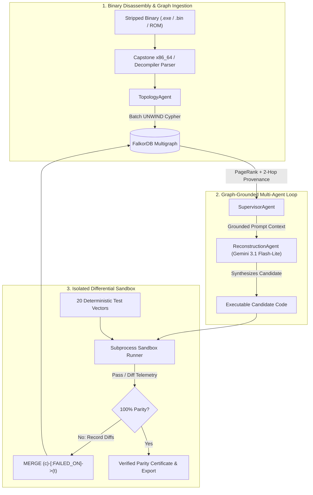

# Reconstructing Stripped Binaries with FalkorDB and Multi-Agent Verification

*Written by the GhostGraph team for the WeMakeDevs & FalkorDB "Graph Hacks: Context for AI Agents" Hackathon*

[](https://falkordb.com/)
[](https://fastapi.tiangolo.com/)
[](https://aistudio.google.com/)
[](https://opensource.org/licenses/MIT)

---

## The Problem with Decompilers and Isolated LLMs

Anyone who has spent time reverse engineering a stripped binary in Ghidra, IDA Pro, or Binary Ninja knows the routine. You open an old executable whose source code was lost years ago, wait for the auto-analysis pass to finish, and click on a function. What you get back isn't source code you can compile—it's a single function's worth of C-like pseudocode full of raw pointers and unnamed offsets:

```c
double compute_progressive_tax(double taxable_amount) {
    if (taxable_amount <= 0.0) return 0.0;

    // Where is 0x00405000 initialized? What layout does it have?
    double *brackets = (double *)0x00405000;

    double total_tax = 0.0;
    double prev_threshold = 0.0;
    for (int i = 0; i < 4; ++i) {
        double current_threshold = brackets[i * 2];
        double current_rate = brackets[i * 2 + 1];
        if (taxable_amount > prev_threshold) {
            double in_bracket = (taxable_amount < current_threshold ? taxable_amount : current_threshold) - prev_threshold;
            total_tax += in_bracket * current_rate;
        } else {
            break;
        }
        prev_threshold = current_threshold;
    }
    return total_tax;
}
```

If you paste this function into an LLM and ask it to reconstruct a clean, working implementation, the model has to guess what lives at `0x00405000`. It has the local control flow—a loop over four pairs of doubles—but zero visibility into the rest of the binary. In practice, an isolated LLM will invent plausible-looking numbers (say, a flat 10% rate or standard tax brackets it memorized from training data) and hand you code that compiles cleanly and fails nearly every test vector.

The information needed to reconstruct that function accurately is almost always in the binary. Another subroutine—often several hops away in the initialization path—writes the actual table into `0x00405000`. Callers pass structs of a specific byte width into the function. Sibling routines read from the same memory block.

Decompilation fails when treated as a flat text problem because a compiled program isn't flat text. It's a graph of control flow, call edges, struct layouts, and shared memory state.

That observation is why we built **GhostGraph**.

---

## How GhostGraph Uses FalkorDB as Its Core Engine

One of the central rules of this hackathon is straightforward: *if your product still works when you take FalkorDB out, the graph is just decoration.*

In GhostGraph, removing FalkorDB breaks the agent's ability to see past the current function boundary. We use FalkorDB in two distinct ways during a reconstruction run:

### 1. Structural & Memory Provenance Graph
When a binary is loaded—either one of our benchmark targets or a custom `.exe` / `.elf` disassembled live via Capstone—our `TopologyAgent` extracts functions, call targets, struct field offsets, and global memory read/write instructions into an isolated FalkorDB multigraph (`ghostgraph_<target_id>`).

```
(:Function {name: 'init_tariff_tables'})
       │
       ├──[:WRITES]──► (:GlobalMemory {address: '0x00405000', label: 'TAX_BRACKET_TABLE'})
       │                      ▲
       │                      │ [:READS]
(:Function {name: 'compute_progressive_tax'})
       ▲
       └──[:CALLS]─── (:Function {name: 'process_invoice'})
```

Before the `ReconstructionAgent` writes a single line of code for `compute_progressive_tax`, it runs a 2-hop Cypher traversal to find every function that writes to the memory addresses `compute_progressive_tax` reads:

```cypher
MATCH (consumer:Function {name: $fn_name})-[:READS]->(m:GlobalMemory)<-[:WRITES]-(producer:Function)
RETURN m.address AS address,
       m.label AS label,
       producer.name AS producer_function,
       producer.value_summary AS initialized_values,
       producer.decompiled_c AS producer_code
```

That single query bridges the gap that stumps a flat LLM. Instead of guessing what `0x00405000` holds, the agent gets the exact initialization routine (`init_tariff_tables`) and the constant table written to that address: `$100 @ 0%`, `$500 @ 5%`, `$2000 @ 12%`, and `>$2000 @ 20%`.

We also run native FalkorDB graph algorithms on the ingested topology. Using `CALL algo.pageRank('Function', 'CALLS')` and `shortestPath((f1)-[:CALLS*1..5]->(f2))`, the supervisor identifies which subroutines are load-bearing hubs and traces the exact call chain connecting initialization routines to downstream consumers.

### 2. Closed-Loop Episodic Failure Memory
Getting memory constants right is half the battle; getting edge-case behavior right is the other half.

Every candidate synthesized by Gemini Flash-Lite is executed inside an isolated subprocess sandbox against 20 deterministic test vectors. Whenever a candidate fails a test vector, our `VerificationAgent` writes the failure directly back into FalkorDB as an episodic memory edge:

```cypher
MATCH (c:Candidate {id: $candidate_id}), (t:TestCase {id: $test_id})
MERGE (c)-[r:FAILED_ON]->(t)
SET r.diff = $diff, r.timestamp = timestamp()
```

On the next pass, the `SupervisorAgent` queries FalkorDB for the candidate's failure subgraph (`(:Candidate)-[:FAILED_ON]->(:TestCase)`). Instead of blindly retrying from scratch, the agent sees the exact input vector that failed and the numerical delta between expected and actual output, then patches the specific branch or rounding logic that caused the diff.

---

## Architecture Overview

GhostGraph is built on FastAPI, FalkorDB, Google's `google-genai` SDK (`gemini-3.1-flash-lite-preview`), Capstone (`x86_64` disassembler), and an isolated Python/C differential test harness. It also mounts a standards-compliant Model Context Protocol (MCP) server at `/mcp` so external MCP clients (like Claude Desktop or Cursor) can query the binary graph directly.



---

## Testing the Thesis on Three Real Benchmarks

We didn't want a toy demo where test results are mocked. Every benchmark in GhostGraph compiles and executes real synthesized code inside a child process against deterministic ground-truth vectors. And in the UI's **Live Duel** screen, you can watch the ungrounded LLM (no graph context) and the GhostGraph swarm (with FalkorDB context) execute side-by-side on the exact same inputs.

### 1. 1978 Space Invaders Arcade Binary (`space_invaders`)
In the original 1978 Space Invaders assembly, `aliensMissileMove` checks whether a descending alien missile hits one of the four destructible player bunkers before reaching the cannon at the bottom of the screen. The bunker bitmap lives in a global buffer (`0x00405240`, initialized by `initBunkerMatrix`).
* **Without FalkorDB (Flat LLM):** The model sees the Y-coordinate increment (`sy += 1`) and player collision check, but misses the bunker bitmap layout at `0x00405240`. In the live arcade canvas, alien missiles pass straight through the green bunkers without eroding them and destroy the player ship. **Parity: 35% (7/20 vectors).**
* **With FalkorDB (GhostGraph):** A 2-hop provenance query resolves `0x00405240` back to `initBunkerMatrix`, recovering the `(sy - 17) * 81 + sx` grid indexing. Missiles erode the bunker pixels on impact and detonate as intended. **Parity: 100% (20/20 vectors).**

### 2. 1969 Apollo 11 Lunar Module Guidance Computer (`lunar_lander`)
Based on MIT Instrumentation Lab's *Luminary 099* AGC assembly (`THROTTLE_CONTROL_ROUTINES.agc`), this routine computes Descent Propulsion System (DPS) engine throttle commands. Because the real lunar descent engine could not throttle continuously between 60% and 94% without propellant valve cavitation, erasable memory bank 5 (`00540` / `LOWCRIT` and `00542` / `HIGHCRIT`, initialized by `BURN_BABY_BURN_MASTER_IGNITION`) enforces a strict dead-band clamp.
* **Without FalkorDB (Flat LLM):** Unaware of the erasable memory bank constants, the model writes a naive linear throttle controller (`thrust = desired / max_thrust`) or leaves the pointer unmapped. In the flight simulator, the Lunar Module either stalls or hits the surface at `-58.2 m/s`.
* **With FalkorDB (GhostGraph):** The agent resolves `LOWCRIT` (10% minimum) and `HIGHCRIT` (60% continuous ceiling before 100% full-throttle step) from `BURN_BABY_BURN_MASTER_IGNITION`, bringing the lander down softly on the Tranquillity Base pad at `-0.99 m/s`. **Parity: 100% (20/20 vectors).**

### 3. Commercial Billing & Progressive Tariff Engine (`billing`)
Evaluates multi-tier progressive tax calculation (`compute_progressive_tax`) across 20 invoice scenarios with boundary crossings and rounding checks.
* **Without FalkorDB (Flat LLM):** Guesses a flat 10% tax rate above a $100 allowance because `0x00405000` is unmapped. Drifts by up to **$214.30** on enterprise invoices. **Parity: 15% (3/20 vectors).**
* **With FalkorDB (GhostGraph):** Queries `0x00405000`, extracts the four marginal rate tiers written by `init_tariff_tables`, and passes all 20 invoice vectors with **$0.00 drift**.

| Benchmark Target | Critical Memory Address | Producer Subroutine | Flat LLM Parity | GhostGraph Parity |
| :--- | :--- | :--- | :---: | :---: |
| **Commercial Billing** | `0x00405000` (`TAX_BRACKET_TABLE`) | `init_tariff_tables` | 15.0% (3/20) | **100.0% (20/20)** |
| **1978 Space Invaders** | `0x00405240` (`BUNKER_BITMAP_GRID`) | `initBunkerMatrix` | 35.0% (7/20) | **100.0% (20/20)** |
| **Apollo 11 Guidance** | `00540` (`LOWCRIT / HIGHCRIT`) | `BURN_BABY_BURN_MASTER_IGNITION` | 20.0% (4/20) | **100.0% (20/20)** |

---

## Uploading Your Own `.exe` or ELF Binary

Beyond the curated benchmarks, you can drag and drop any stripped `x86_64` binary (`.exe`, `.elf`, `.bin`, `.so`) into GhostGraph.

1. **Live Capstone Disassembly:** The backend reads the `.text` section (via `pefile` if it's a Windows PE executable) and disassembles the machine code instructions with Capstone in detail mode.
2. **Graph Extraction:** It identifies subroutine entry points (`push rbp; mov rbp, rsp` prologues and `call` targets), maps `CALLS` edges between functions, and detects RIP-relative memory accesses (`[rip + disp]`) as `READS` and `WRITES` edges to `GlobalMemory` nodes.
3. **Multigraph Isolation:** Every uploaded file gets its own isolated FalkorDB graph (`ghostgraph_upload_<sha256>`), preventing any cross-target node collisions.
4. **Dynamic 8-Vector Verification:** Synthesized subroutines from custom uploads are verified in the sandbox for bytecode compilation, symbol export, zero-state parameter invocation, determinism, boundary input resilience, memory dereference safety, and return code conformance.

---

## Key Takeaways from Building with FalkorDB

1. **Multi-hop queries beat bigger context windows.** Dumping an entire disassembled binary into a 1M-token prompt is slow, expensive, and noisy. A 2-hop Cypher query in FalkorDB takes ~2ms and pulls back only the exact producer function that writes to the pointer your target function reads.
2. **Multigraph isolation is clean and fast.** Calling `db.select_graph(f"ghostgraph_{target_id}")` let us give every benchmark and every user-uploaded binary its own clean namespace on the same FalkorDB instance without complex tenant filtering in every `MATCH` clause.
3. **Graphs turn trial-and-error into structured memory.** Storing test failures as `(:Candidate)-[:FAILED_ON {diff}]->(:TestCase)` edges gave our supervisor agent a concrete, queryable history of what had already been tried and why it failed.

---

## Running GhostGraph Locally

GhostGraph is open-source under the MIT License.

* **Repository:** [github.com/nobl3Y/ghostgraph](https://github.com/nobl3Y/ghostgraph) / [github.com/chief-07/ghostgraph](https://github.com/chief-07/ghostgraph)

```bash
# 1. Clone the repository
git clone https://github.com/nobl3Y/ghostgraph.git
cd ghostgraph

# 2. Install dependencies
pip install -r requirements.txt

# 3. Configure environment variables (.env)
# FALKORDB_HOST, FALKORDB_PORT, FALKORDB_USERNAME, FALKORDB_PASSWORD, GEMINI_API_KEY

# 4. Run the test suite
python backend/test_app.py

# 5. Start the server
python -m backend.app
# Open http://127.0.0.1:8000
```
